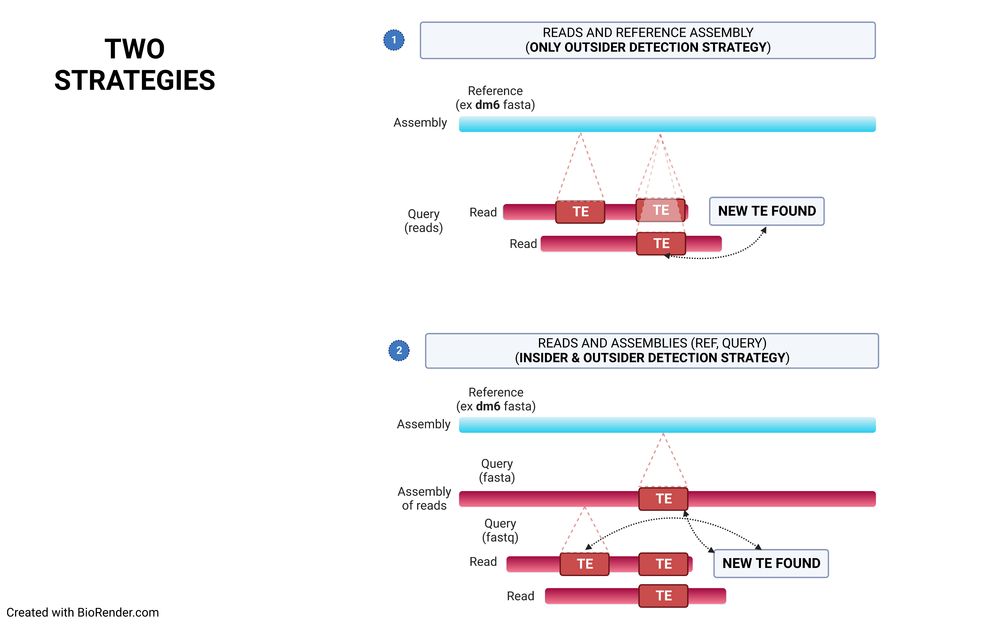
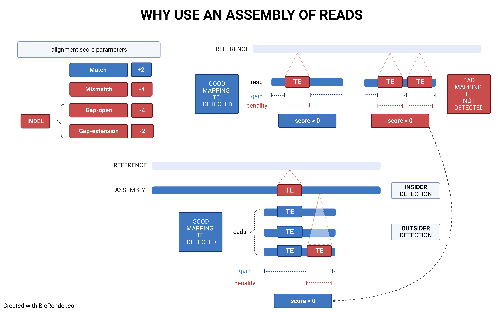
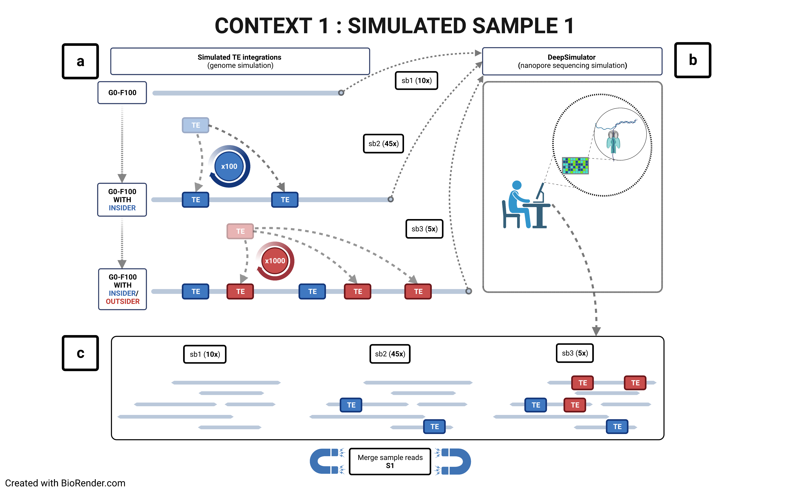
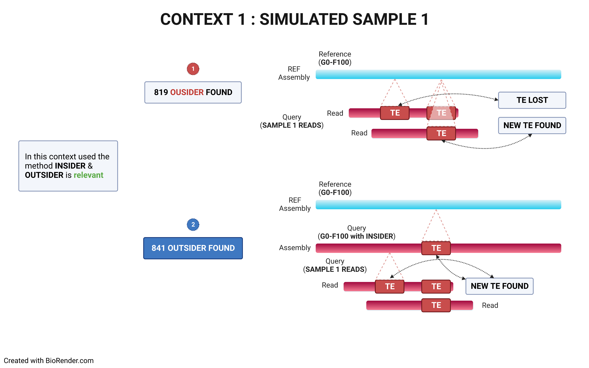
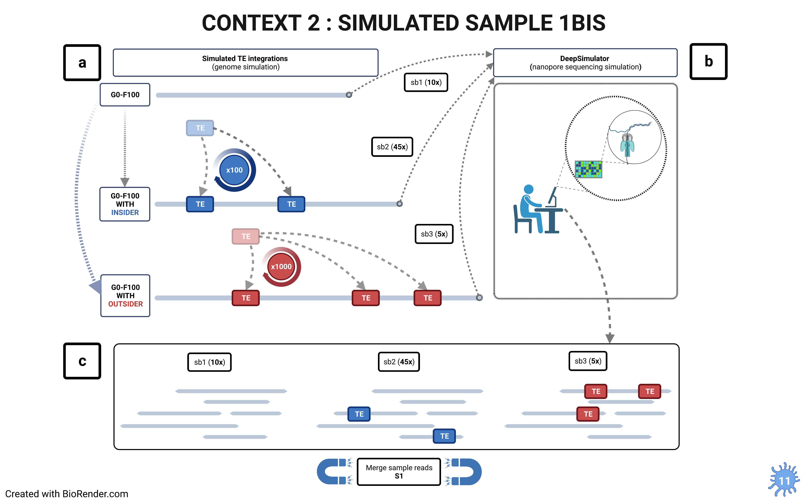
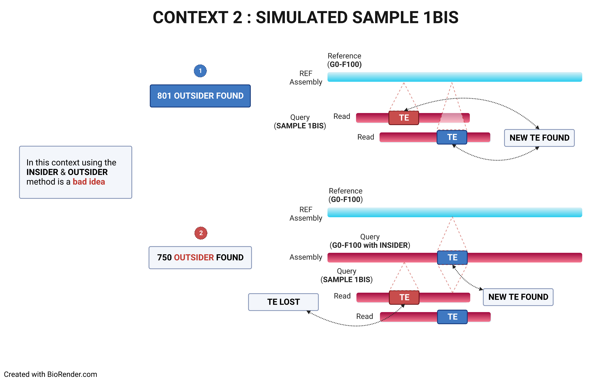
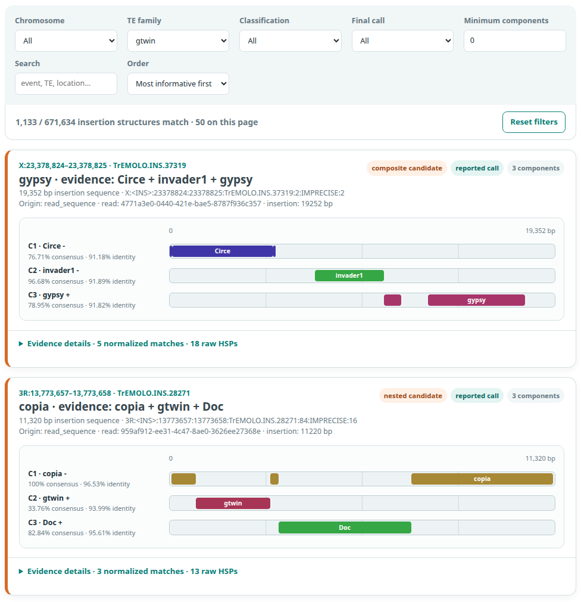

# TrEMOLO


**Transposable Elements MOvement detection using LOng reads**

TrEMOLO detects TE-associated variation using long reads and genome assemblies.
INSIDER compares assemblies; OUTSIDER maps reads to an assembly to identify
variation within the sequenced sample or population.

**Current development version: `3.0.0-beta.1`.** This is a proposed beta release;
no release tag or new downloadable image is published by this documentation.
The supported entry point is `workflow/Snakefile`. Read the
[beta release notes](docs/release-notes-functional-candidate.md) before migrating
from 2.x: corrected evidence extraction and integration intentionally change
some scientific results. Use a fresh output directory.

[How TrEMOLO works and which strategy to choose](#how-tremolo-works) ·
[Quick start](#quick-start) · [Your data](#run-with-your-own-data) · [Modules](#modules) · [GFA](#build-a-gfa)

## Quick start

Prerequisites: a Linux x86_64 machine with Singularity (or Apptainer) installed,
Git, and access to the input/output directories. Building the image below needs
administrator privileges and Internet access to download dependencies. Once a
current image is available, running analyses does not need `sudo`.

Use an image built from the current [Singularity recipe](Singularity).
The local development image is named `TrEMOLO-3.simg`; that filename
alone does not establish its version. The old 2.5.4b download is a legacy image
and is not the recommended environment for this beta.

The commands below run **from the directory containing the TrEMOLO checkout
and the image**. They use the bundled small fixture. Start with a fresh
`work_v3_test` directory; do not remove an existing analysis to rerun it.

```bash
git clone https://github.com/DrosophilaGenomeEvolution/TrEMOLO.git
# If the checkout already exists, use it instead of cloning again.
# Build only if you do not already have a current image:
sudo singularity build TrEMOLO-3.simg TrEMOLO/Singularity

singularity exec TrEMOLO-3.simg python3 TrEMOLO/lib/python/tremolo_version.py
singularity exec TrEMOLO-3.simg snakemake \
  --snakefile TrEMOLO/workflow/Snakefile \
  --configfile TrEMOLO/tests/workflow/v3_config.yml \
  --cores 8 all
```

Open `work_v3_test/REPORT/report.html` in a browser. It needs no server or
network connection. Keep `REPORT/report-help.html` beside the HTML when sharing
to preserve contextual help links. Apptainer can replace `singularity` where installed.
For data outside the container's default mounts, bind the relevant directory
and use paths visible inside the container.

For your own data, copy an [example configuration](examples/config), replace
input/output paths and pass it with `--configfile`. YAML paths resolve from the
working directory of the command. Prefer absolute paths for your own analyses.
`--cores` limits the total scheduled CPU allocation; `PARAMS.THREADS` requests
threads for individual jobs.

## Run with your own data

### First OUTSIDER analysis (reads mapped to an assembly)

Save the following configuration as `my-analysis.yaml`. Replace the four absolute paths. Use paths without spaces
(some workflow shell commands still require this). `GENOME` is the assembly
used for read mapping; it can be a reference assembly or your sample assembly.
The preset below is for Oxford Nanopore reads.

```yaml
DATA:
  GENOME: /absolute/path/assembly.fasta # Assembly used as the read-mapping target (FASTA)
  SAMPLE: /absolute/path/reads.fastq.gz # Sample long reads (FASTQ or gzipped FASTQ)
  TE_DB: /absolute/path/original_TE_database.fasta # TE sequence database (multi-FASTA)
  WORK_DIRECTORY: /absolute/path/new_outsider_output # New directory for all analysis outputs

CHOICE:
  PIPELINE:
    OUTSIDER_VARIANT: true # Detect TE-associated variation using read mappings
    INSIDER_VARIANT: false # Assembly comparison disabled; enabling it requires DATA.REFERENCE
    TE_GENOME: false # Optional catalogue of resident TEs in the assembly
    UNMAPPED_TE: true # Search unmapped reads for TE matches; requires DATA.SAMPLE
    REPORT: true # Generate the interactive HTML report and offline help
  OUTSIDER_VARIANT:
    CALL_SV: sniffles1 # Structural-variant caller: sniffles1 or sniffles2
    CLIPPED_READS: false # Set true to include soft/hard-clipped read evidence
    INTEGRATE_TE_TO_GENOME: false # Optional reconstruction with detected insertions

PARAMS:
  THREADS: 8 # Threads requested per job; total allocation is limited by --cores
  OUTSIDER_VARIANT:
    MINIMAP2:
      PRESET_OPTION: map-ont # Minimap2 preset for Oxford Nanopore reads

TOOLS:
  QUARTO: /opt/quarto/bin/quarto # Report renderer inside the current container
```

From the directory containing `TrEMOLO/`, the image and `my-analysis.yaml`,
preview the jobs, then run the same command without `--dry-run`:

```bash
singularity exec TrEMOLO-3.simg snakemake \
  --snakefile TrEMOLO/workflow/Snakefile \
  --configfile my-analysis.yaml --cores 8 --dry-run all
```

Open `/absolute/path/new_outsider_output/REPORT/report.html` when the run finishes;
`TE_INFOS.bed` contains the variant-associated calls. To resume an interrupted
analysis, rerun the same command without `--dry-run` and keep its output directory.
Use a new directory for a different analysis, caller or scientific configuration.

| Change you need | What to edit in the YAML |
| --- | --- |
| Compare assemblies only | Use [insider.yaml](examples/config/insider.yaml): add `DATA.REFERENCE`, enable `INSIDER_VARIANT`, disable `OUTSIDER_VARIANT`; reads are unnecessary |
| Combine assembly comparison and read mapping | Use [combined.yaml](examples/config/combined.yaml): provide both `REFERENCE` and `SAMPLE`, enable both variant branches |
| Use Sniffles 2 | Set `CHOICE.OUTSIDER_VARIANT.CALL_SV: sniffles2` |
| Include clipped-read evidence | Set `CHOICE.OUTSIDER_VARIANT.CLIPPED_READS: true` |
| Catalogue TEs already in the assembly | Set `CHOICE.PIPELINE.TE_GENOME: true`; its catalogue is separate from variant calls |
| Keep only chosen chromosomes | Set `PARAMS.OUTSIDER_VARIANT.TE_DETECTION.CHROM_KEEP`, e.g. `'^([23][RL]|[X4Y])$'` for exact main dm6 names; resident annotation uses its own `PARAMS.TE_GENOME.CHROM_KEEP` |

Merge settings into the existing YAML sections; do not repeat a top-level key
such as `DATA`, `CHOICE` or `PARAMS`. Use YAML booleans `true`/`false` without
quotes, and spaces for indentation. INSIDER-only runs have no read-based
empty-site frequency estimate; that estimate requires OUTSIDER mapping evidence.

Gzipped FASTQ inputs are accepted directly. With `CLIPPED_READS: true`, input
preparation automatically decompresses gzip reads into `WORK_DIRECTORY/INPUT/reads.fastq`
for indexing; allow disk space for the uncompressed file. The original input is
preserved. Without clipped-read analysis, reads remain linked to the input.

For other sequencing technologies, choose the matching Minimap2 preset before
running. See the [configuration reference](docs/configuration.md) for thresholds,
integration, genomic windows and executable overrides.

If your data are on a disk outside the default container mounts, add a bind:
`singularity exec --bind /data:/data TrEMOLO-3.simg snakemake ...`.
Use the same `/data/...` paths in the YAML. A dry run checks the job graph and
input paths; the fixture run above also checks execution of the scientific tools.

## Choose an analysis

| Goal | Required scientific inputs | Mode or command | Main result |
| --- | --- | --- | --- |
| Compare assemblies | Assembly, reference, TE database | `INSIDER_VARIANT` | Variant-associated TE calls |
| Detect within-sample variation | Reads, mapping assembly, TE database | `OUTSIDER_VARIANT` | Variant-associated calls and read frequencies |
| Catalogue resident TEs | Assembly, TE database | `TE_GENOME` | Copy/fragment tables, BED, GFF3 |
| Examine unmapped reads | Reads, assembly, TE database | `UNMAPPED_TE` | Read-coordinate TE evidence |
| Compare timepoints/replicates | Call tables on the same reference, reference FASTA | Module 1 | Frequency trajectories |
| Inspect insertion structures | OUTSIDER direct-channel BLAST and size tables | Module 2 | Insertion evidence explorer |
| Export an insertion graph | Calls, raw insertion evidence, reference, original TE database | GFA exporter | GFA, representation balance and audit tables |

Optional features have independent settings. See the
[configuration reference](docs/configuration.md), [workflow targets](workflow/README.md)
and [documentation index](docs/README.md).

## How TrEMOLO works

### Which strategy should I use?

TrEMOLO supports two complementary strategies. Both require a TE sequence database:

- **Strategy 1 — OUTSIDER only:** map long reads directly to a reference assembly
  supplied as `DATA.GENOME`. This requires reads and a suitable mapping reference,
  without first assembling the sequenced sample.
- **Strategy 2 — INSIDER and OUTSIDER:** compare the sample assembly
  (`DATA.GENOME`) to a reference (`DATA.REFERENCE`) with INSIDER, then map the
  sample reads to their own assembly with OUTSIDER. The two branches capture
  complementary variation relative to these assemblies.



An insertion-rich read can be difficult to align directly to a reference lacking
those insertions. A sample assembly can provide a closer mapping target, while
INSIDER identifies TE-associated differences between that assembly and the
reference. The diagram below illustrates why combining the two branches can
recover evidence missed by direct read-to-reference mapping. The alignment
scores shown are illustrative, not a list of current workflow defaults.



### Examples with simulated data

The best strategy depends on the sample, reference and assembly quality. These
original simulated examples illustrate two contexts; they are not benchmarks
of the current beta or a guarantee that one strategy always performs better.

#### Context 1: the combined strategy performs better





#### Context 2: direct read-to-reference mapping performs better





Use the [minimal OUTSIDER or combined configurations](examples/config) to select
one of these strategies. For frequency estimates and missing calls, see
[interpreting results](docs/interpreting-results.md).

## Version and reproducibility

`VERSION` is the single source of the application version. Workflow startup,
module startup and the GFA command display the version, full Git commit and a
modified-checkout marker when applicable. Git is queried in the source checkout,
not the container's bundled checkout. An archive without Git reports the commit
as unavailable; it never invents a commit identifier.

```bash
python3 TrEMOLO/lib/python/tremolo_version.py
python3 TrEMOLO/lib/python/tremolo_version.py --json
TrEMOLO/module --version
python3 TrEMOLO/lib/python/locus/build_te_gfa.py --version
```

An executing Snakemake workflow writes `WORK_DIRECTORY/log/run-version.json`.
A dry run displays the banner without creating this file. The file describes the
latest execution, including resumed jobs; it does not establish the origin of
all pre-existing outputs. Version identity does not replace input checksums,
configuration, tool versions or the container image checksum. See
[recording a reproducible run](docs/real-run-regression.md).

## Installation and requirements

The current container was built and tested with **Singularity 3.8.5**.

The current image includes the scientific stack, Sniffles 1 and 2, Liftoff and
Quarto. Check the actual image before an analysis:

```bash
singularity exec TrEMOLO-3.simg snakemake --version
singularity exec TrEMOLO-3.simg sniffles --help
singularity exec TrEMOLO-3.simg sniffles2 --version
singularity exec TrEMOLO-3.simg /opt/quarto/bin/quarto --version
singularity exec TrEMOLO-3.simg /opt/conda/envs/liftoff_env/bin/liftoff --version
```

The migrated workflow and modules use Quarto and browser JavaScript for reports.
R/Bookdown requirements belong to the historical `run.snk` report. A persistent
Node server is not required. For native installations, the recipe records the
scientific dependencies; the tested legacy workflow environment uses Snakemake
5.10 and Python 3.8. Do not assume compatibility with every newer Snakemake release.

Editing the recipe does not update an existing image. With an older image lacking
Quarto, see the [workflow environment notes](workflow/README.md); building the
current image is the recommended route for a new installation.

## Results and interpretation

Start with `TE_INFOS.bed`, `REPORT/report.html` and the original-name exports in
`PUBLIC/`. The [output guide](docs/outputs.md) describes their schemas and optional
branch outputs. The [interpretation guide](docs/interpreting-results.md) explains
missing calls, frequency, alternative families and coordinate systems.

Integration can skip unresolved insertions with warnings by default; inspect
`INTEGRATION_TE.tsv` and the report. Set `INTEGRATION_ALLOW_PARTIAL: false` for
strict failure. The reconstructed population genomes concatenate same-site
alternatives and should not be interpreted as observed haplotypes.

## Modules

Run these commands from the parent of the checkout, using paths visible inside
the container. Module 1 expects a TSV manifest; its input BED files must share
the same reference coordinates.

```bash
singularity exec TrEMOLO-3.simg TrEMOLO/module build 1 \
  -i samples.tsv -g reference.fasta -o POPULATION_REPORT

singularity exec TrEMOLO-3.simg TrEMOLO/module build 2 \
  work_v3_test STRUCTURE_REPORT
```

- [Module 1: population frequency trajectories](modules/1-FREQUENCY-MULTI-GENERATIONS/README.md).
  Its HTML is self-contained. Missing calls remain missing.
- [Module 2: insertion structure explorer](modules/2-MODULE_TE_BLAST/README.md).
  Share the whole output directory: `report-assets/` must remain beside the HTML.
  Structure classifications are provisional hypotheses.



## Build a GFA

This is an explicit post-processing command, independent of the `all` target:

```bash
singularity exec TrEMOLO-3.simg python3 TrEMOLO/lib/python/locus/build_te_gfa.py \
  --reference work_v3_test/INPUT/genome.fasta \
  --te-database TrEMOLO/test/canonical_TE.fa \
  --reference-name fixture \
  --run fixture=work_v3_test \
  --output work_v3_test/GFA
```

Open `GFA/summary.html` to inspect represented and excluded calls. Supported
OUTSIDER insertions become alternatives on synthetic, unphased walks. Defaults
are 80% identity, 80% TE coverage and 100 aligned bp; they are independent of
pipeline thresholds. Only chromosomes present in the input BED are exported by
default. See [GFA selection, limitations and output files](docs/te-gfa.md).

## Migration and validation

`workflow/Snakefile` is the sole workflow entry point in v3. The 2.x generated
workflow and its shell environment have been removed; previous implementations
remain available in Git history. See the [v3 compatibility audit](docs/v3-compatibility-audit.md)
for coverage, retired options and validation limits.

See [regression procedures](tests/regression/README.md),
[historical migration validation](docs/migration-validation.md) and
[beta release validation status](docs/release-notes-functional-candidate.md).
The historical 434-call oracle predates scientific corrections; counts from a
current run can differ intentionally. SyRI/consensus backends and full Savanache
application compatibility are not included in the beta's validated scope.

## Other utilities

[Assembly correction utilities](docs/assembly-correction.md) reorder and orient
assembly blocks with audited base retention.

## Citation and licence

Documentation is licensed under [CC BY 4.0](https://creativecommons.org/licenses/by/4.0/).
See [CeCILL-C](Licence_CeCILL-C_V1-en.txt) and [GPLv3](LICENSE) for software licences.

Please cite Mohamed et al., **TrEMOLO: accurate transposable element allele
frequency estimation using long-read sequencing data combining assembly and
mapping-based approaches**, Genome Biology 24, 63 (2023),
[doi:10.1186/s13059-023-02911-2](https://doi.org/10.1186/s13059-023-02911-2).

See also Mohamed et al., **A Transposon Story: From TE Content to TE Dynamic
Invasion of Drosophila Genomes Using the Single-Molecule Sequencing Technology
from Oxford Nanopore**, Cells 9, 1776 (2020),
[doi:10.3390/cells9081776](https://doi.org/10.3390/cells9081776).
[Paper datasets](https://dataverse.ird.fr/dataverse/tremolo_data).
