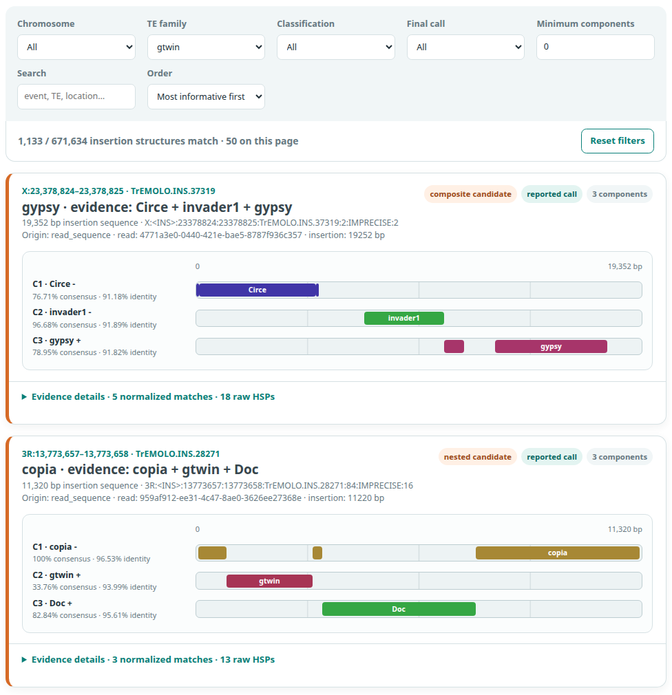

# Insertion structure explorer

This module normalizes the BLAST alignments between OUTSIDER insertion
sequences and the TE database. It is designed to expose competing TE matches,
possible composite insertions and possible repeated or nested structures
without silently converting them into confirmed biological components.

## Real-data example



This screenshot shows two adjacent cards from the real-data report
`ouput_module2/index.html`, with **TE family = `gtwin`** and the default
**Most informative first** ordering. The filter controls and selected cards
are grouped into one excerpt for readability.

- **Upper card — `X:23,378,824–23,378,825 · TrEMOLO.INS.37319`:**
  the reported TE is `gypsy`, while the 19,352 bp query contains provisional
  `Circe`, `invader1` and `gypsy` components. The report labels it
  `composite candidate`; five normalized matches summarize 18 raw BLAST HSPs.
- **Lower card — `3R:13,773,657–13,773,658 · TrEMOLO.INS.28271`:**
  the reported TE is `copia`, while the 11,320 bp query contains provisional
  `copia`, `gtwin` and `Doc` components. The report labels it `nested candidate`;
  three normalized matches summarize 13 raw BLAST HSPs.

The family filter includes queries with a matching family among their evidence,
including rejected matches. In the upper card, the `gtwin` match is rejected,
so it is available under **Evidence details** but does not appear among the
three provisional components. In the lower card, `gtwin` is a component.

The bars show positions within each insertion sequence; split blocks preserve
separate aligned intervals. The `+` and `−` signs indicate orientation. The
percentages below each component report TE consensus coverage and alignment
identity. `Reported call` means the event is present in `TE_INFOS.bed`; it does
not validate every proposed component. Composite and nested classifications
remain hypotheses requiring independent confirmation of linkage and
breakpoints. The screenshot is shared with the repository's main README.

## Run

```bash
./module build 2 WORK_DIRECTORY [OUTPUT_DIRECTORY]
```

The default output is `WORK_DIRECTORY/MODULE_TE_BLAST`. The module consumes:

- `OUTSIDER/TrEMOLO_SV_TE/INS/SV_INS_CLUST.bln`;
- `OUTSIDER/TrEMOLO_SV_TE/INS/SV_SIZE.tsv`;
- `1-UTILS/TE_SIZE.tsv`;
- `TE_INFOS.bed`, when available, to mark final reported events;
- `TE_CALL_CANDIDATES.tsv`, when available, to identify known alternatives.
- `SEQUENCE_PROVENANCE.tsv` and insertion-only FASTA companions, when present in
  the work directory, to associate queries with source reads or VCF-reported
  alleles. The cards show this origin; `insertion-sequence-provenance.tsv` retains
  it with insertion hashes. Unknown origins remain explicit. See
  [candidate provenance](../../docs/te-call-candidates.md).
  When available, the same sidecars retain the raw SAM flag and primary,
  secondary or supplementary status of the exact source genomic alignment.
  The cards and `insertion-sequence-provenance.tsv` expose this metadata;
  VCF-reported sequences are not applicable and missing older flags are unknown.
  This is independent of BLAST-hit ranking. The module never scans BAM files
  to recover missing flags.

Scientific thresholds can be passed after the output directory:

```bash
./module build 2 work_test STRUCTURE_REPORT \
  --min-pident 90 \
  --min-aligned-bp 80 \
  --min-consensus-coverage 20 \
  --max-component-overlap 0.2
```

All raw HSPs are preserved regardless of thresholds. Thresholds only determine
the normalized match status and the provisional component proposal.

## Outputs

```text
STRUCTURE_REPORT/
  insertion-hsps.tsv
  insertion-matches.tsv
  insertion-components.tsv
  insertion-structures.tsv
  insertion-events.tsv
  manifest.json
  report-data.json
  report-assets/
  report.qmd
  report.html
  index.html
```

- `insertion-hsps.tsv` contains every BLAST HSP in 0-based half-open query and
  subject coordinates, with explicit filter reasons.
- `insertion-matches.tsv` chains HSPs by query, TE and orientation and records
  union coverage, weighted identity, score, final-call status and assignment.
- `insertion-components.tsv` contains a conservative, non-overlapping set of
  coordinate-supported matches for each query sequence.
- `insertion-structures.tsv` describes each supporting insertion sequence.
- `insertion-events.tsv` aggregates all supporting sequences belonging to the
  same TrEMOLO event. This is the preferred table for finding events supported
  by several query sequences.

Event classifications distinguish:

- `multi_te_candidate`: multiple TE families occur on one supporting sequence;
- `multi_te_supported`: the pattern occurs on at least two supporting
  sequences;
- `repeated_or_rearranged_te_candidate/supported`: several components have the
  same TE label;
- `single_candidate`, `unresolved`, and `no_match`.

These labels remain hypotheses. A composite or nested biological allele should
only be promoted after read/assembly evidence confirms linkage and breakpoints.

The report is an offline Quarto HTML bundle. **Keep `report-assets/` beside
`report.html` or `index.html` when copying or sharing it.** Open either HTML
file directly; no server or network connection is needed. Quarto renders only
the document shell, instead of parsing all BLAST evidence as one large string.
The sequence index is split into script chunks and evidence is loaded on demand
with a bounded cache. The complete `report-data.json` export is streamed to disk
and is not read by Quarto or the browser.

Its primary view is a paginated structure landscape: every insertion sequence remains available,
while coordinate-scaled TE components, orientations, consensus coverage and
identity are visible directly on each card. Multi-component and
alternative-rich structures appear first by default without hiding the other
sequences. Chromosome, TE family, classification, final-call, component-count
and free-text filters can narrow the landscape. Each card exposes normalized
matches and raw BLAST HSPs on demand, including rejection reasons. Structure
and event views show 50 entries per page, with previous/next buttons, page
numbers and a direct page selector. Filters and ordering cover the complete
sequence index, including sequences without a retained match.

The historical Node server, global repository symlink and CDN dependencies are
no longer used. Normalization still holds alignment records in Python memory;
this change removes the oversized Quarto input and the unbounded HTML gallery,
without changing scientific thresholds or discarding evidence.
The refactored Singularity definition includes Quarto; with an older image,
run the wrapper from a host installation of Quarto instead.
